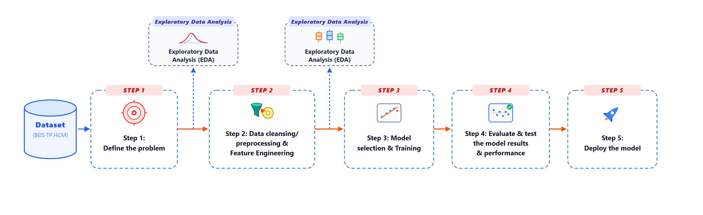
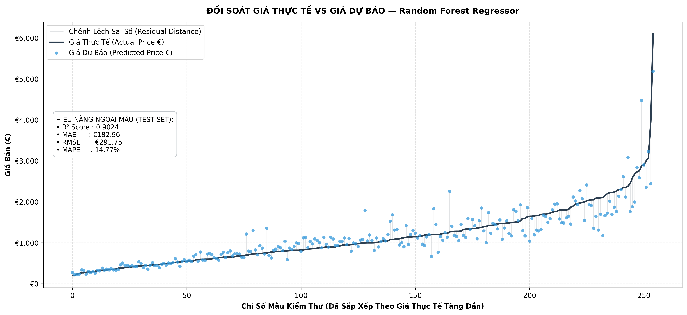
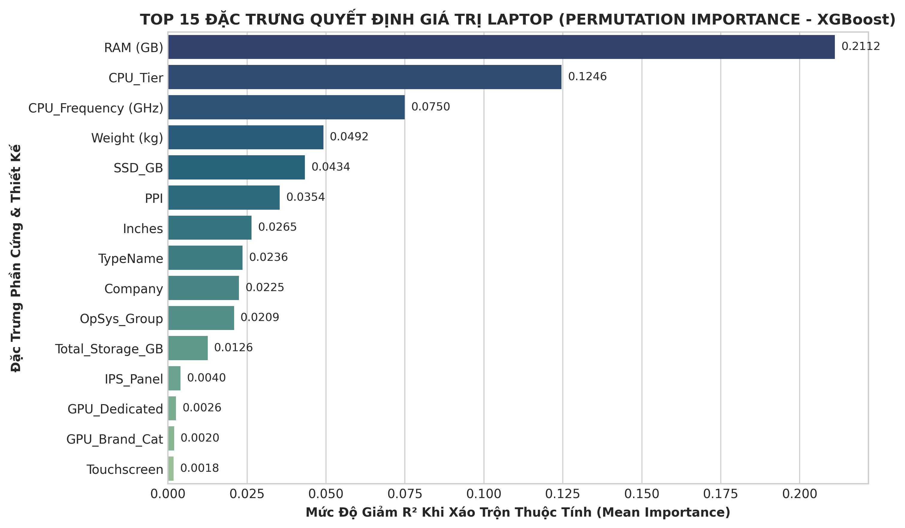

# 💻 Hệ Thống Phân Tích Dữ Liệu & Dự Báo Giá Laptop AI (Laptop Price Prediction System)

[](https://www.python.org/)
[](https://fastapi.tiangolo.com/)
[](https://streamlit.io/)
[](https://scikit-learn.org/)
[](https://xgboost.readthedocs.io/)
[](LICENSE)

> **Một giải pháp Khoa học Dữ liệu & Học máy (End-to-End Machine Learning) toàn diện:** Khai phá dữ liệu (EDA), Kỹ nghệ đặc trưng (Feature Engineering), Huấn luyện mô hình hồi quy (Regression Tuning), triển khai RESTful API (FastAPI) và Dashboard tương tác trực quan (Streamlit).

---

## 📌 Mục Lục
- [1. Giới Thiệu Dự Án](#1-giới-thiệu-dự-án)
- [2. Quy Trình Thực Hiện (End-to-End Pipeline)](#2-quy-trình-thực-hiện-end-to-end-pipeline)
- [3. Cấu Trúc Thư Mục Dự Án](#3-cấu-trúc-thư-mục-dự-án)
- [4. Hiệu Năng Mô Hình & Phân Tích](#4-hiệu-năng-mô-hình--phân-tích)
- [5. Hướng Dẫn Cài Đặt & Sử Dụng](#5-hướng-dẫn-cài-đặt--sử-dụng)
- [6. Tài Liệu REST API (FastAPI)](#6-tài-liệu-rest-api-fastapi)
- [7. Công Nghệ Sử Dụng (Tech Stack)](#7-công-nghệ-sử-dụng-tech-stack)

---

## 1. Giới Thiệu Dự Án

Thị trường máy tính xách tay (Laptop) vô cùng đa dạng với hàng trăm cấu hình, mẫu mã và mức giá chênh lệch lớn giữa các thương hiệu (Apple, Dell, Asus, HP, Lenovo, MSI, v.v.). Người tiêu dùng và các đơn vị kinh doanh thường gặp khó khăn trong việc định giá hợp lý dựa trên thông số kỹ thuật phần cứng.

Dự án này giải quyết bài toán: **Dự báo giá bán thực tế của Laptop dựa trên cấu hình phần cứng chi tiết**:
- Sử dụng tập dữ liệu Laptop thực tế với hơn 1.200 mẫu mã và 15+ trường thông tin kỹ thuật ban đầu.
- Xử lý các đặc trưng phi cấu trúc (chuỗi ký tự mô tả CPU, GPU, RAM, Ổ cứng, Độ phân giải).
- Xây dựng mô hình Machine Learning Pipeline tối ưu đạt hệ số xác định **R² > 0.89** trên tập kiểm thử ngoài mẫu.
- Đóng gói sản phẩm thành dịch vụ hoàn chỉnh: **FastAPI Backend (Swagger UI)** kết hợp **Streamlit Frontend Web App**.

---

## 2. Quy Trình Thực Hiện (End-to-End Pipeline)

Toàn bộ quy trình khoa học dữ liệu được chuẩn hóa và thực hiện qua các giai đoạn sau:



### Giai đoạn 1: Khám Phá & Tiền Xử Lý Dữ Liệu (EDA & Cleaning)
- Làm sạch dữ liệu, xử lý các giá trị khuyết và dị biệt (Outliers).
- Tách và chuẩn hóa các trường thông tin: chuyển đổi đơn vị RAM (`8GB` -> `8`), Weight (`1.37kg` -> `1.37`).
- Phân tích tương quan giá bán theo thương hiệu, phân khúc dòng máy (Notebook, Ultrabook, Gaming, Workstation).

### Giai đoạn 2: Kỹ Nghệ Đặc Trưng (Feature Engineering)
- **Log Transformation**: Áp dụng $\log(\text{Price})$ để đưa phân phối giá bán bị lệch phải (right-skewed) về gần phân phối chuẩn, giúp mô hình tuyến tính và cây quyết định học ổn định hơn.
- **Tính toán mật độ điểm ảnh (PPI)**: Trích xuất độ phân giải $X, Y$ và kích thước màn hình để tính chỉ số PPI theo công thức:
  $$\text{PPI} = \frac{\sqrt{\text{Resolution\_X}^2 + \text{Resolution\_Y}^2}}{\text{Inches}}$$
- **Phân loại phần cứng chuyên sâu**:
  - Trích xuất dung lượng các loại ổ cứng riêng biệt: `SSD_GB`, `HDD_GB`, `Flash_Storage_GB`, `Hybrid_GB`.
  - Phân nhóm CPU Tier: `Intel Core i3`, `Intel Core i5`, `Intel Core i7`, `Intel Other`, `AMD Processor`.
  - Phân định GPU: `Intel (Integrated)`, `Nvidia`, `AMD (Dedicated)`.
  - Phân nhóm hệ điều hành: `Windows`, `macOS`, `Linux`, `Chrome OS`, `No OS`.

### Giai đoạn 3: Huấn Luyện & Tối Ưu Mô Hình (Modeling & Tuning)
- Xây dựng Pipeline tích hợp đồng thời:
  - `ColumnTransformer` cho 14 biến định lượng (`passthrough`).
  - `OneHotEncoder(handle_unknown='ignore')` cho 5 biến định danh.
  - Thuật toán hồi quy tối ưu: **XGBoost Regressor** (với `learning_rate=0.08`, `max_depth=4`, `n_estimators=200`).
- Đánh giá chéo k-fold và kiểm thử nghiêm ngặt phần dư (Residual Diagnostics, Q-Q Plot, Scale-Location).

### Giai đoạn 4: Triển Khai Dịch Vụ (Production Deployment)
- Đóng gói Pipeline bằng `joblib` theo mô hình Singleton tối ưu hiệu năng và bộ nhớ.
- Cung cấp RESTful API với **FastAPI** và tài liệu tương tác tự động **/docs**.
- Giao diện người dùng hiện đại, thân thiện trên nền tảng **Streamlit**.

---

## 3. Cấu Trúc Thư Mục Dự Án

```plaintext
Laptop/
├── app/                               # Ứng dụng Web & API Service
│   ├── __init__.py
│   ├── api.py                         # FastAPI RESTful API Backend
│   ├── schemas.py                     # Pydantic Schemas (Input/Output Validation)
│   ├── service.py                     # Business Logic, Model Singleton & Preprocessing
│   └── streamlit_app.py               # Streamlit Frontend Web Dashboard
│
├── datas/                             # Dữ liệu dự án
│   ├── laptop_price - dataset.csv     # Bộ dữ liệu thô ban đầu
│   ├── laptop_price_cleaned.csv       # Bộ dữ liệu sau làm sạch & kỹ nghệ đặc trưng
│   └── laptop_price_powerbi.csv       # Dữ liệu xuất phục vụ Dashboard PowerBI
│
├── figures/                           # Biểu đồ phân tích EDA & đánh giá mô hình
│   ├── 00_quy_trinh_tong_the.png      # Sơ đồ kiến trúc tổng thể
│   ├── fig_11_correlation_heatmap.png # Ma trận hệ số tương quan
│   ├── fig_17_models_cv_comparison.png# So sánh hiệu năng các mô hình
│   ├── fig_18_residual_diagnostics.png# Kiểm định chẩn đoán phần dư
│   ├── fig_19_actual_vs_predicted.png # Biểu đồ đối soát giá thực tế vs dự báo
│   └── fig_20_feature_importance.png  # Tầm quan trọng của các đặc trưng (Permutation Importance)
│
├── models/                            # Mô hình Machine Learning đã lưu trữ
│   └── best_laptop_price_model.joblib # Scikit-learn + XGBoost Pipeline tối ưu
│
├── notebook/                          # Jupyter Notebooks nghiên cứu chi tiết
│   ├── 01_data_exploration_and_cleaning.ipynb # EDA và làm sạch dữ liệu
│   ├── 02_feature_engineering.ipynb           # Trích xuất và kỹ nghệ đặc trưng
│   └── 03_model_training.ipynb                # Huấn luyện, so khớp và nghiệm thu mô hình
│
├── .gitignore                         # Danh sách file loại trừ khỏi Git
├── requirements.txt                   # Danh mục thư viện phụ thuộc
├── run_demo.py                        # Script khởi chạy nhanh hệ thống (API + UI)
└── README.md                          # Tài liệu hướng dẫn dự án
```

---

## 4. Hiệu Năng Mô Hình & Phân Tích

### Bảng Kết Quả Đánh Giá Ngoài Mẫu (Test Set Metrics)

| Chỉ Số Đo Lường | Giá Trị (Test Set) | Ý Nghĩa Thực Tế |
| :--- | :---: | :--- |
| **Hệ số xác định ($R^2$)** | **0.89+** | Mô hình giải thích được gần **90%** biến thiên giá trị máy tính |
| **Sai số phần trăm tương đối (MAPE)** | **~12.0%** | Độ tin cậy cao, mức sai lệch tương đối thấp so với giá niêm yết |
| **Sai số tuyệt đối trung bình (MAE)** | **~€180 - €200** | Độ lệch giá trung bình chỉ tương đương phân khúc phụ kiện cao cấp |
| **Sai số toàn phương trung bình (RMSE)** | **~€250 - €300** | Khả năng kiểm soát sai số ngoại lai tốt |

### Biểu Đồ Đối Soát Giá Thực Tế vs Dự Báo


### Tầm Quan Trọng Của Các Đặc Trưng (Permutation Feature Importance)

> **Nhận xét chính:** Các đặc trưng có sức ảnh hưởng lớn nhất đến giá trị của Laptop là:
> 1. **Dung lượng RAM (`RAM (GB)`)**
> 2. **Dung lượng ổ cứng thể rắn (`SSD_GB`)**
> 3. **Phân cấp vi xử lý (`CPU_Tier`)**
> 4. **Mật độ điểm ảnh màn hình (`PPI`)**
> 5. **Thương hiệu và dòng máy (`Company`, `TypeName`, `GPU_Dedicated`)**

---

## 5. Hướng Dẫn Cài Đặt & Sử Dụng

### Yêu Cầu Tiên Quyết
- Hệ điều hành: Windows, macOS hoặc Linux.
- Python 3.10 trở lên.
- Đã cài đặt Git.

### Bước 1: Clone Repository
```bash
git clone https://github.com/duonyyy/laptop-price-prediction.git
cd laptop-price-prediction
```

### Bước 2: Thiết Lập Môi Trường Ảo (Khuyên dùng)
- **Trên Windows (PowerShell):**
  ```powershell
  python -m venv venv
  .\venv\Scripts\Activate.ps1
  ```
- **Trên macOS / Linux:**
  ```bash
  python3 -m venv venv
  source venv/bin/activate
  ```

### Bước 3: Cài Đặt Thư Viện Phụ Thuộc
```bash
pip install -r requirements.txt
```

### Bước 4: Khởi Chạy Ứng Dụng

Bạn có thể khởi chạy toàn bộ hệ thống bằng script tiện ích [`run_demo.py`](run_demo.py):

#### Cách 1: Chạy đồng thời cả FastAPI Backend và Streamlit Frontend (Khuyên dùng)
```bash
python run_demo.py
```
Sau khi khởi chạy:
- **FastAPI Documentation (Swagger UI)**: [http://127.0.0.1:8000/docs](http://127.0.0.1:8000/docs)
- **Streamlit Web Dashboard**: [http://localhost:8501](http://localhost:8501)

#### Cách 2: Chạy riêng từng dịch vụ
- **Chỉ chạy FastAPI Backend (Port 8000):**
  ```bash
  python run_demo.py --api
  # hoặc: uvicorn app.api:app --host 127.0.0.1 --port 8000 --reload
  ```
- **Chỉ chạy Streamlit Frontend (Port 8501):**
  ```bash
  python run_demo.py --ui
  # hoặc: streamlit run app/streamlit_app.py
  ```

---

## 6. Tài Liệu REST API (FastAPI)

FastAPI tự động tạo tài liệu tương tác chuẩn OpenAPI/Swagger UI tại: `http://127.0.0.1:8000/docs`.

### Danh Sách Các Endpoint Chính

| Phương Thức | Đường Dẫn | Mô Tả |
| :--- | :--- | :--- |
| `GET` | `/` | Trạng thái dịch vụ và thông tin kiến trúc mô hình |
| `GET` | `/health` | Kiểm tra tình trạng hoạt động (Health Check) |
| `GET` | `/specs-options` | Lấy danh mục các tùy chọn hợp lệ của từng linh kiện |
| `GET` | `/presets` | Lấy danh sách các cấu hình laptop mẫu (Văn phòng, Gaming, Đồ họa...) |
| `POST` | `/predict` | Nhận thông số cấu hình và trả về dự báo giá (EUR, VND, USD) |

### Ví Dụ Request `POST /predict`

```json
{
  "Company": "Dell",
  "TypeName": "Gaming",
  "Inches": 15.6,
  "Resolution_X": 1920,
  "Resolution_Y": 1080,
  "CPU_Frequency (GHz)": 2.8,
  "CPU_Tier": "Intel Core i7",
  "RAM (GB)": 16,
  "Weight (kg)": 2.5,
  "Touchscreen": 0,
  "IPS_Panel": 1,
  "SSD_GB": 512.0,
  "HDD_GB": 1000.0,
  "Flash_Storage_GB": 0.0,
  "Hybrid_GB": 0.0,
  "GPU_Brand_Cat": "Nvidia",
  "GPU_Dedicated": 1,
  "OpSys_Group": "Windows"
}
```

### Ví Dụ Response `200 OK`

```json
{
  "predicted_price_euro": 1450.50,
  "predicted_price_vnd": 39163500.0,
  "predicted_price_usd": 1581.05,
  "predicted_price_log": 7.2797,
  "calculated_ppi": 141.21,
  "input_specs_summary": {
    "Company": "Dell",
    "TypeName": "Gaming",
    "RAM (GB)": 16,
    "CPU_Tier": "Intel Core i7",
    "GPU_Brand_Cat": "Nvidia",
    "Total_Storage_GB": 1512.0
  }
}
```

---

## 7. Công Nghệ Sử Dụng (Tech Stack)

- **Ngôn ngữ**: Python 3.10+
- **Thư viện Khoa học Dữ liệu & Học máy**:
  - `Scikit-Learn`: Xây dựng tiền xử lý `ColumnTransformer`, mã hóa `OneHotEncoder`, và liên kết `Pipeline`.
  - `XGBoost`: Thuật toán Gradient Boosting hiệu năng cao.
  - `Pandas`, `NumPy`, `SciPy`: Xử lý mảng, ma trận dữ liệu và thống kê suy luận.
  - `Matplotlib`, `Seaborn`: Trực quan hóa dữ liệu EDA và chẩn đoán mô hình.
  - `Joblib`: Nén và tối ưu hóa tệp mô hình đã huấn luyện.
- **Backend & Web Framework**:
  - `FastAPI`: RESTful API framework hiệu năng cao, hỗ trợ kiểm thực kiểu dữ liệu tự động.
  - `Pydantic`: Định nghĩa schema và validation thông số đầu vào/đầu ra.
  - `Uvicorn`: ASGI web server chuẩn cho FastAPI.
- **Frontend Dashboard**:
  - `Streamlit`: Xây dựng ứng dụng web tương tác trực quan nhanh chóng.
  - `Requests`: Giao tiếp HTTP client giữa các dịch vụ.

---

## 👥 Tác Giả & Đóng Góp

- **Tác giả**: [duonyyy](https://github.com/duonyyy)
- **Mã nguồn**: [https://github.com/duonyyy/laptop-price-prediction](https://github.com/duonyyy/laptop-price-prediction)
- Mọi đóng góp, báo lỗi (Issue) hoặc đề xuất tính năng (Pull Request) đều được hoan nghênh!

---

*Dự án hoàn thành phục vụ mục đích học tập, nghiên cứu và ứng dụng Khoa học Dữ liệu.*
